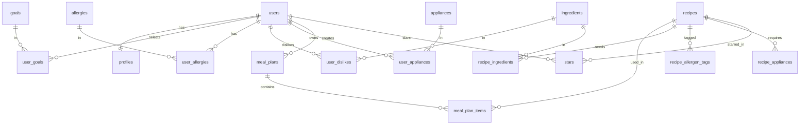

# PLAN.md: Weekly Cooking Companion

Items marked **(confirm)** are proposals for you to confirm or change before submitting. The professor asked for specific decisions, so please make each one your own.

## 1. Pitch

"I'm building a personalized recipe website because I struggle to plan what to cook during the week while respecting my diet, my budget and the ingredients I like or dislike." I expect to use it about 3 to 4 times per week. It is also for anyone with the same pain points (busy students and professionals, people on a budget, people with dietary restrictions), which is why sign up and login are required.

Core idea: the user's profile (diet, allergies, dislikes, appliances, budget) is saved once and checked BEFORE any recipe is recommended.

## 2. Features

Format: "As a ___, I want ___, so that ___." Numbered in build order.

**Spine features** (course requirements)

1. **Sign up and login:** As a new visitor, I want to create my own account from inside the app, then log in and log out, so that every account is a row in the users table and each user sees only their own data.
2. **Data model:** As a user, I want my data organized in a users table plus tables of my own (recipes, meal plans, ingredients and stars) connected by relationships, so that recipes belong to me and meal plans link to recipes.
3. **Create, read, update, delete:** As a user, I want to add a recipe, view my recipe list, open one recipe's detail page, edit it, and delete it with an "are you sure?" confirmation, so that I keep full control of my recipe collection.
4. **Validation:** As a user, I want the app to stop me from leaving required fields blank (recipe title, ingredients, instructions, servings) and to show a friendly message, so that I never save an incomplete recipe.
5. **Stars:** As a user, I want to star recipes and see a "starred" view, with all stars stored in one stars table where each row says "this user starred this recipe", so that I find my favorites quickly.
6. **Find things:** As a user, I want to search recipes by name or ingredient, filter by cuisine, diet tag, cost bracket and cook time, and sort (newest first, shortest cook time, lowest cost), so that I find the right recipe fast.
7. **Dashboard:** As a user, I want a dashboard with at least one chart (recipes by cuisine) and 2 to 3 summary stats computed from my data (total recipes, number of starred recipes, number of meal plans created), so that I understand my cooking habits.

**Real data requirement:** the app must contain at least 5 real entries of my own by the due date. I will send 5 recipes that I actually cook, with real ingredients and instructions (no placeholder text), and they are added to the database as my own entries. The other 95 recipes are collected from the internet (see Technologies).

**My extra features**

8. **Onboarding questionnaire:** As a new user, I want to answer questions about my goals, diet, allergies, dislikes, appliances and starting point, so that the app knows me before recommending anything.
9. **Meal prep plan:** As a user, I want a weekly meal prep plan generated from my servings, number of days, available time and budget bracket ($, $$, $$$), so that I cook once and eat well all week.
10. **Single recipe suggestion:** As a user, I want a recipe suggestion based on the fresh ingredients I have in my fridge (for example meat, vegetables, garlic, onion) and on whether I can shop extra items, so that I reduce waste and last minute shopping. If no recipe can be made only with what I already have, the app suggests recipes that use some of my ingredients and clearly lists the additional items I would need to buy. Spices, olive oil and butter are not considered in this comparison, because everyone is assumed to have them.
11. **Instagram recipe import:** As a user, I want to import a recipe from Instagram by pasting the caption text or link, so that I can save recipes I find on social media.

**Rules that apply to every feature**

* Allergies and dietary needs are hard filters. A recipe containing an allergen is never shown.
* Dislikes are soft filters. The app avoids them by default and can offer a substitution.
* The goals selection (maximum 3) shapes sorting, not filtering. For example, "save money" favors cheaper recipes and "improve cooking skills" favors more technique.
* Spices, olive oil and butter are assumed to be available to everyone and are ignored when comparing a recipe with the user's fridge.

**Scope note:** the seven spine features plus the questionnaire, two recommendation flows and the Instagram import are a substantial amount of work for one assignment, so the feature list stops at 11. Build the spine (1 to 7) first, then the extras (8 to 11) in order.

## 3. Database

Primary keys are `id` (integer or UUID) in every table.

**users**
| Column | Type |
|---|---|
| id (PK) | number/UUID |
| email | text (unique) |
| password_hash | text |
| created_at | date |

**profiles** (one-to-one with users)
| Column | Type |
|---|---|
| id (PK) | number |
| user_id (FK to users) | number |
| diet_type | text (none, vegetarian, vegan, pescatarian) |
| budget_bracket | text ($, $$, $$$) |
| onboarding_completed | true/false |
| start_preference | text (meal prep, single recipe) |

**goals** (lookup list): id (PK), name (text)
**user_goals** (many-to-many between users and goals, maximum 3 per user): user_id (FK), goal_id (FK)

**allergies** (lookup list): id (PK), name (text)
**user_allergies** (many-to-many): user_id (FK), allergy_id (FK)

**ingredients**: id (PK), name (text), category (text), is_staple (true/false, for spices, olive oil and butter), is_custom (true/false), created_by_user_id (FK, nullable)
**user_dislikes** (many-to-many between users and ingredients): user_id (FK), ingredient_id (FK)

**appliances** (lookup list): id (PK), name (text: microwave, oven, airfryer, stove)
**user_appliances** (many-to-many): user_id (FK), appliance_id (FK)

**recipes**
| Column | Type |
|---|---|
| id (PK) | number |
| title | text |
| cuisine | text |
| instructions | text |
| prep_minutes | number |
| cook_minutes | number |
| base_servings | number |
| cost_bracket | text ($, $$, $$$) |
| diet_tags | text (vegan, vegetarian, pescatarian) |
| source_type | text (seed, user, instagram) |
| source_url | text (optional, for Instagram imports and recipes collected from the internet) |
| created_by_user_id (FK, nullable) | number |

**recipe_ingredients** (many-to-many between recipes and ingredients): recipe_id (FK), ingredient_id (FK), quantity (number), unit (text)
**recipe_allergen_tags** (many-to-many): recipe_id (FK), allergy_id (FK)
**recipe_appliances** (many-to-many): recipe_id (FK), appliance_id (FK)

**stars** (junction table, one table for all users): id (PK), user_id (FK to users), recipe_id (FK to recipes), starred_at (date). Each row means "this user starred this recipe". The pair (user_id, recipe_id) is unique, so a recipe cannot be starred twice by the same user.

**meal_plans** (one-to-many from users): id (PK), user_id (FK), servings_per_meal (number), days (number), time_available_minutes (number), budget_bracket (text), created_at (date)
**meal_plan_items** (one-to-many from meal_plans): id (PK), meal_plan_id (FK), recipe_id (FK), day_number (number)

**Relationship diagram**

Privacy rule: recipes with source_type "user" or "instagram" are visible only to their creator (checked with created_by_user_id). Seed recipes are shared read only. Stars, meal plans and profiles are always filtered by the logged in user.

Design note: the fridge contents for the single recipe flow are treated as temporary input (not stored) to keep the database simple. Store them later only if needed.

## 4. Tests

The coding agent writes the 2 tests, matching the scenarios below.

**Test 1 (data isolation: User B cannot see User A's data)**
Given two registered users, where User A has created a recipe and starred it, when User B logs in and opens the recipe list, the starred view and the direct link to User A's recipe, then User B sees an empty list, an empty starred view and a "not found" page.

**Test 2 (dashboard: one summary stat calculates correctly)**
Given a user who has starred exactly three recipes, when the user opens the dashboard, then the "number of starred recipes" stat shows 3.

**What I must include in the pull request for each test**

* **Plain English explanation:** what the test creates, does and checks.
  * Test 1: "This test creates two users, adds and stars a recipe for User A, logs in as User B, and checks that User B's list, starred view and direct link show nothing."
  * Test 2: "This test creates a user, stars three recipes, opens the dashboard, and checks that the number of starred recipes shows 3."
* **Red, then green:** ask the agent to temporarily break the feature, run the test and screenshot it failing, revert the break, run it again and screenshot it passing.
* **What would break it:** one sentence on a real change that would make the test fail.
  * Test 1: removing the filter by logged in user from the recipe query would make User B see User A's recipe.
  * Test 2: counting the stars of all users instead of only the logged in user would show the wrong number.
* **Bugs found:** if the agent got something wrong and I caught it, document in the pull request what happened, how I noticed and how I fixed it.

## 5. Technologies

All **(confirm)**:

* **Coding agent:** Claude Code, because it can build and run the project from my plan and iterate on errors.
* **Frontend and backend:** Next.js (React), because one framework covers the pages and the server logic. The product is a website, not a mobile app: it will be responsive so it looks and works well when opened in a phone browser, without the added backend complexity of a native app.
* **Database:** PostgreSQL through Supabase (or SQLite if a simpler local setup is preferred), because the data is relational (users, recipes, ingredients, many-to-many links).
* **Sign up and login:** Supabase Auth (email and password), because it handles password hashing and sessions securely so I do not build authentication myself.
* **Hosting:** Vercel, because it deploys a Next.js app from GitHub in minutes and has a free tier.
* **Recipe data:** 100 recipes in total: the 5 I send plus 95 collected from the internet by the coding agent, with a variety of cuisines and ingredients available in the US. They are converted into a JSON seed file and loaded into the database, because this avoids API limits and lets me control allergen and cost tags. Each internet recipe keeps its source URL, and its instructions are rewritten in the agent's own words (ingredient lists can be kept), because copying recipe text word for word from websites can infringe copyright. A recipe API such as Spoonacular is an alternative but adds cost and complexity.
* **UI library:** Tailwind CSS, because it speeds up consistent styling.
* **Charts:** Recharts, because it integrates easily with React and is enough for the dashboard chart.
* **Instagram import:** the user pastes the caption text and an AI model (Claude API) converts it into structured fields (title, ingredients, steps), because Instagram restricts automated access to links and pasted text is far more reliable. If only a link is pasted, the app asks the user to paste the caption.

## 6. Design

* **Style:** warm, clean and appetizing. Lots of white space, large food photos, rounded cards, one clear action per screen.
* **Colors:** warm off white background (#FAF7F2), deep green for primary actions (#2F6B4F), tomato or terracotta accent (#D9573B), dark charcoal text (#2B2B2B). Budget and diet tags use small neutral badges.
* **Typography:** a friendly serif for recipe titles and a clean sans serif for everything else.
* **Navigation:** five tabs: Meal Prep, Single Recipe, My Recipes (list, search, filters, sort and the starred view), Dashboard, Profile. A website with a responsive layout, so it looks and works well when opened on a phone, because many people cook with a phone in the kitchen.
* **Onboarding:** a step by step questionnaire with a progress bar, one question per screen, with chips for multiple choice.
* **Inspiration apps:** Mealime (meal planning flow), Muse (personalization by diet and dislikes), ReciMe (meal planning tab, Instagram recipe copies).

## 7. Risks and cuts

* **Least sure I can build:** the Instagram import, because turning an unstructured caption into clean ingredients and steps is unreliable and Instagram restricts automated access. A close second is the meal prep generator, which must balance time, servings, budget, appliances and the profile filters across several recipes at once.
* **What I will cut first, in order (the seven spine features are never cut):**
  1. Instagram recipe import (feature 11)
  2. Budget bracket logic inside the meal plan (keep it only as a recipe tag filter)
  3. Goal based sorting (keep goals saved in the profile but do not use them to rank)
  4. Appliance matching (keep appliances saved but do not filter by them)
  5. Single recipe suggestion (feature 10), keeping meal prep as the main recommendation flow
* **Other risks:**
  * Allergen mistakes: tagging recipes manually can be wrong, so the app must show a disclaimer that users should verify ingredients.
  * Cost estimates by bracket are approximations, not real prices.
  * Collecting 95 recipes from the internet and tagging them correctly takes time and can introduce errors (duplicates, wrong allergen or diet tags, broken sources). I will have the agent work in batches and I will manually review the allergen tags.
