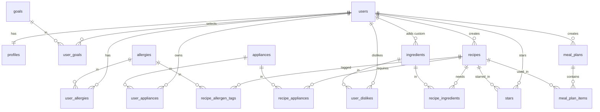

# Database schema

The database is PostgreSQL on Supabase. Table definitions live in [`supabase/migrations/`](supabase/migrations/).
Every table has **Row Level Security** turned on, so the database itself checks that each user can only read and change their own rows.

## Tables at a glance

| Group | Tables |
|---|---|
| Accounts | `users`, `profiles` |
| My preferences | `user_goals`, `user_allergies`, `user_dislikes`, `user_appliances` |
| Lookup lists | `goals`, `allergies`, `appliances` |
| Recipes | `recipes`, `ingredients`, `recipe_ingredients`, `recipe_allergen_tags`, `recipe_appliances` |
| Stars (junction table) | `stars` |
| Meal plans | `meal_plans`, `meal_plan_items` |

## Diagram

## Tables

**PK** = primary key, **FK** = foreign key (points to a row in another table).

### users
One row per account, created automatically on sign up. Passwords are **not** stored here: Supabase Auth keeps them, hashed, in its own `auth.users` table.

| Column | Type | Notes |
|---|---|---|
| id | uuid | PK, same id as the Supabase Auth account |
| email | text | unique |
| created_at | date/time | |

### profiles (one-to-one with users)
Created empty on sign up, then filled in by the onboarding questionnaire.

| Column | Type | Notes |
|---|---|---|
| id | number | PK |
| user_id | uuid | FK → users, unique (one profile per user) |
| diet_type | text | `none`, `vegetarian`, `vegan`, `pescatarian` |
| budget_bracket | text | `$`, `$$`, `$$$` |
| onboarding_completed | true/false | |
| start_preference | text | `meal prep` or `single recipe` |

### Lookup lists: goals, allergies, appliances
Same list for everyone, read-only. Each has `id` (number, PK) and `name` (text, unique).

- **goals:** Save money, Save time, Eat healthier, Eat more protein, Improve cooking skills
- **allergies:** the 9 major US allergens (Milk, Eggs, Fish, Shellfish, Tree nuts, Peanuts, Wheat, Soy, Sesame)
- **appliances:** Stove, Oven, Microwave, Air fryer

### user_goals, user_allergies, user_appliances, user_dislikes (many-to-many)
Each row says "this user has this goal / allergy / appliance / dislike". The PK is the pair of FKs, so the same pair can't be saved twice.

| Table | Columns |
|---|---|
| user_goals | user_id (FK → users), goal_id (FK → goals). **Maximum 3 per user**, enforced by the database |
| user_allergies | user_id (FK → users), allergy_id (FK → allergies) |
| user_appliances | user_id (FK → users), appliance_id (FK → appliances) |
| user_dislikes | user_id (FK → users), ingredient_id (FK → ingredients) |

### ingredients

| Column | Type | Notes |
|---|---|---|
| id | number | PK |
| name | text | unique (case-insensitive) among shared ingredients |
| category | text | e.g. vegetable, meat, dairy |
| is_staple | true/false | spices, olive oil, butter: ignored when comparing with the fridge |
| is_custom | true/false | added by a user |
| created_by_user_id | uuid | FK → users, empty for shared ingredients |

### recipes

| Column | Type | Notes |
|---|---|---|
| id | number | PK |
| title | text | required |
| cuisine | text | |
| instructions | text | required |
| prep_minutes, cook_minutes | number | |
| base_servings | number | required, more than 0 |
| cost_bracket | text | `$`, `$$`, `$$$` |
| diet_tags | list of text | e.g. `{vegan, vegetarian}` |
| source_type | text | `seed` (shared library), `user`, `instagram` |
| source_url | text | where a seed recipe came from |
| image_url, image_credit | text | Unsplash photo and photographer credit |
| created_by_user_id | uuid | FK → users. Empty only for seed recipes |
| created_at | date/time | used for "newest first" |

### recipe_ingredients, recipe_allergen_tags, recipe_appliances (many-to-many)

| Table | Columns |
|---|---|
| recipe_ingredients | recipe_id (FK → recipes), ingredient_id (FK → ingredients), quantity (number), unit (text) |
| recipe_allergen_tags | recipe_id (FK → recipes), allergy_id (FK → allergies) |
| recipe_appliances | recipe_id (FK → recipes), appliance_id (FK → appliances) |

### stars (junction table between users and recipes)
**One table for everyone.** Each row means "this user starred this recipe".

| Column | Type | Notes |
|---|---|---|
| id | number | PK |
| user_id | uuid | FK → users |
| recipe_id | number | FK → recipes |
| starred_at | date/time | |

The pair (user_id, recipe_id) is unique, so a user can't star the same recipe twice. A user can only star recipes they are allowed to see.

### meal_plans (one-to-many from users) and meal_plan_items (one-to-many from meal_plans)

| Table | Columns |
|---|---|
| meal_plans | id (PK), user_id (FK → users), servings_per_meal (number), days (number, 1–7), time_available_minutes (number), budget_bracket (text), created_at (date/time) |
| meal_plan_items | id (PK), meal_plan_id (FK → meal_plans), recipe_id (FK → recipes), day_number (number, 1–7) |

## Who can see what (Row Level Security)

| Data | Rule |
|---|---|
| Seed recipes (shared library) | Every logged-in user can read them. Nobody can edit them from the app |
| My own recipes | Only I can read, edit or delete them |
| Profile, goals, allergies, dislikes, appliances, stars, meal plans | Only the user they belong to |
| Lookup lists | Every logged-in user can read them |
| Logged-out visitors | See nothing |

## Plan vs. what was built

Compared with PLAN.md §3, the agent built the tables as designed, with these differences:

| Plan | Built | Why |
|---|---|---|
| `users.password_hash` | No password column | Supabase Auth stores hashed passwords in `auth.users` |
| "Primary keys are `id` in every table" | Many-to-many tables use the pair of FKs as PK | Stops the same pair from being saved twice, and no extra id is needed |
| `recipes.diet_tags`: text | List of text | A recipe can be both vegan and vegetarian |
| No date on recipes | `recipes.created_at` | Needed for the "newest first" sort |
| No photo columns | `recipes.image_url`, `image_credit` | Unsplash photos (decision #4 in the reality log) |
| Max 3 goals (only in the features) | Enforced by the database | The rule holds even if the app has a bug |
